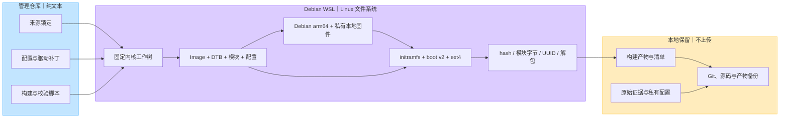

# 工程结构

手机启动关系：ABL 装载 boot_a 中的内核/DTB/initramfs，配合 dtbo_a，再由 initramfs 按 UUID 找到 ext4 根文件系统。项目测试设备的 super 是 sda15；部署前始终按本机分区标签重新核验。4 GiB ext4 写在 7 GiB super 内，属于替换原 Android 动态分区内容，另一个 boot 槽不能保护 super。

持久系统默认 multi-user.target，以 USB DHCP 和公钥 SSH 维护。XFCE 使用有界 transient 会话，LightDM 不默认启用。可用运行状态的各项补装和修复未全部重新封装到原 r1 镜像。

内核、模块和 initramfs 的一致性是核心约束。模块树更换后还应能成组恢复原内核、原模块、initramfs 和相关服务配置。
