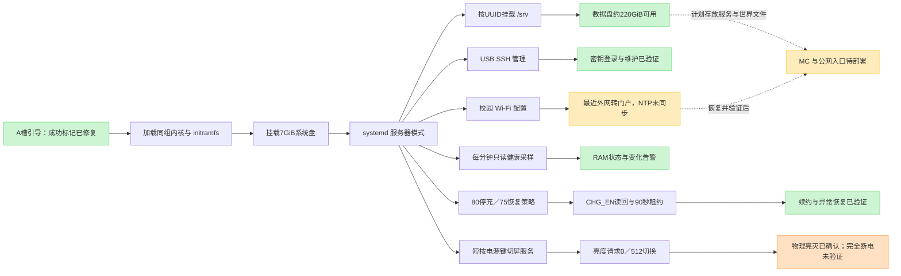

# 项目结构与流程图（2026-10-04）

[打开可编辑 FigJam 画板](https://www.figma.com/board/dIWts4DnLVD4Z0PCGHFpmc)。画板包含“项目交付流程”和“服务器启动与运行流程”两张图，依据[当前状态](project-status-20261004.md)重绘；仓库保留同版 Mermaid 源文件，便于后续更新。

## 阅读方式

绿色表示所列具体检查已通过，黄色表示待处理或待验收，橙色表示部分通过，红色表示恢复路径。实线连接既定流程或运行关系，虚线表示后续计划、条件依赖或失败后的重试。颜色不代替验证范围：限充通过的是停充读回、续约和异常恢复，完整物理80/75周期仍未通过；屏幕亮灭由用户确认，面板完全断电未验证。

交付图按“主机准备 → 设备部署与恢复 → 当前完成与后续验收”展开。恢复节点是操作流程，不表示原厂完整恢复已全部实机验收；授权判断按AGENTS.md的现行范围执行，既有持续授权不重复申请，超范围操作仍须明确授权。

运行图表示配置和职责关系，不是所有服务同时启动的严格时序。新增电源键服务已配置自启并通过运行中短按测试，尚未独立重启复测。校园Wi-Fi曾成功，最近回到认证门户且NTP未同步；MC节点表示未来工作。

## 仓库结构与职责

| 路径 | 负责的内容 | 与手机的关系 |
| --- | --- | --- |
| README.md、AGENTS.md | 当前入口、协作规范、操作授权 | 维护前先读，历史段落不覆盖现行状态 |
| sources.lock.json、config/、patches/ | 固定源码、内核配置、带来源的补丁 | 当前配方r2-charge-policy；内核、DTB、模块成组 |
| scripts/linux/ | 源码准备、DTB/内核构建、打包和产物核验 | 在主机Linux文件系统执行；构建不等于刷写 |
| scripts/ | 备份、明确用途的部署与维护工具 | 按具体工具目标和授权执行，不直接运行社区刷机脚本 |
| docs/、docs/diagrams/ | 状态、专题证据、流程与交接 | 脱敏记录；最新状态链接优先于历史结论 |
| sources/、artifacts/ | 本地源码与成组产物 | 忽略；封存镜像不等同于当前运行中文件系统 |
| local/、firmware/、backups/ | 原始日志、私有配置、固件与恢复副本 | 忽略；不上传镜像、凭据、序列号或个人数据 |

## 手机运行模块

| 模块 | 当前职责 | 专题记录 |
| --- | --- | --- |
| 引导与内核 | A槽成功记账，同组内核/initramfs，内建显示触摸修复 | [r2](r2-integrated-20261004.md)、[成功位修复](boot-success-repair-20261004.md) |
| 存储 | 7GiB系统盘，按UUID挂载/srv数据盘；约220GiB可用 | [扩容](storage-expansion-20261004.md) |
| USB/SSH | 固定管理链路，保留严格host key和私有公钥身份 | [基础配置](server-base-20261004.md) |
| kebab-charge-policy.service | 80/75策略、CHG_EN读回与90秒可续约控制 | [限充](charge-policy-v1-20261004.md) |
| kebab-health.timer | 每分钟只读采样、RAM状态和变化告警 | [基础配置](server-base-20261004.md) |
| kebab-powerkey-screen.service | 短按切换亮度请求0/512，保持服务器运行 | [电源键](powerkey-screen-20261004.md)、[发热](local-heating-20261004.md) |
| 校园Wi-Fi与时钟 | 现有无线配置；重新认证和NTP复验待完成 | [校园网](gdut-wifi-20261004.md) |
| MC与443/WSS | 未部署；由独立会话负责，使用/srv且检查挂载 | [续接提示词](mc-cnb-resume-prompt-20261004.md) |

## 可维护源文件

- [项目交付 Mermaid](diagrams/project-delivery-20261004.mmd)
- [服务器运行 Mermaid](diagrams/server-runtime-20261004.mmd)

图表只保留通用路径、职责和脱敏状态，没有实际地址、UUID、校园账号、令牌、私钥或可用镜像。更新时先核对实机和验证记录，再同步源文件、此页及FigJam，避免只改图中的状态颜色。

## 项目交付流程预览

```mermaid
flowchart LR
    subgraph hostPrep ["主机准备"]
        lockSources["锁定来源与补丁"]
        buildDtb["先构建设备树"]
        buildKernel["构建内核与同组模块"]
        packImages["打包并核验引导组"]
    end
    subgraph deviceDeploy ["设备部署与恢复"]
        scopeCheck{"目标在授权范围？"}
        requestScope["列明目标与恢复方案"]
        backupInputs["备份、槽位与输入核验"]
        writeTarget["更新指定目标并回读"]
        bootCheck{"启动与管理链路正常？"}
        restoreBoot["按已核验方案恢复"]
    end
    subgraph currentPhase ["当前完成与后续验收"]
        persistentLinux["持久 Debian 已运行"]
        baseAccepted["显示触控、存储、限充与短按已验证"]
        fixGaps["热问题、校园认证与校时待排查"]
        deployMc["MC 与 443/WSS 方案待部署"]
        loadTests["物理充电周期与游戏负载待验证"]
        longRun["长期运行与备份恢复待验收"]
    end
    lockSources --> buildDtb --> buildKernel --> packImages --> scopeCheck
    scopeCheck -->|"是"| backupInputs
    scopeCheck -->|"否"| requestScope
    requestScope -->|"明确授权后"| backupInputs
    backupInputs --> writeTarget --> bootCheck
    bootCheck -->|"通过"| persistentLinux
    bootCheck -->|"失败"| restoreBoot
    restoreBoot -.->|"核验输入后重试"| backupInputs
    persistentLinux --> baseAccepted
    baseAccepted -.-> fixGaps
    fixGaps -.->|"前置问题处理后"| deployMc
    deployMc -.-> loadTests
    loadTests -.-> longRun
    style hostPrep fill:#C2E5FF,stroke:#3DADFF
    style deviceDeploy fill:#D9D9D9,stroke:#B3B3B3
    style currentPhase fill:#C6FAF6,stroke:#5AD8CC
    classDef verified fill:#CDF4D3,stroke:#66D575
    classDef pending fill:#FFECBD,stroke:#FFC943
    classDef recovery fill:#FFCDC2,stroke:#FF7556
    class persistentLinux,baseAccepted verified
    class fixGaps,deployMc,loadTests,longRun pending
    class restoreBoot recovery
```

## 服务器运行流程预览

